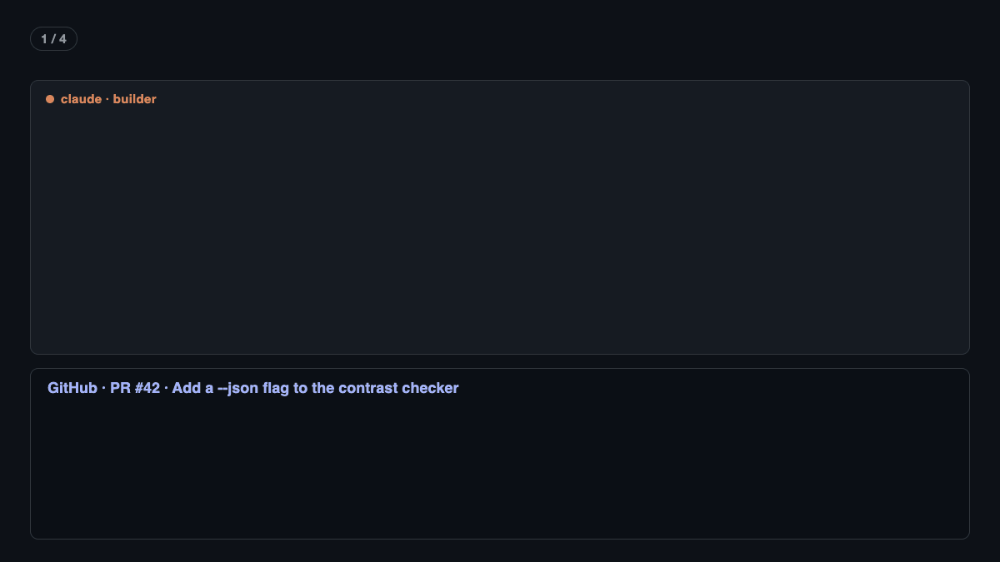

# Minions for Herdr

Every [Herdr](https://herdr.dev) workspace gets two panes: **builder-minion**, the coder, and
**reviewer-minion**. When the builder finishes, its work goes to the reviewer, and the findings
come back to the builder. You do nothing by hand.

For bigger work, `team-up` starts a team of four minions in one workspace, with you as Gru, the
boss. See [team/README.md](team/README.md).



- Defaults: Claude Code codes, Codex reviews. Change them in `config.json`.
- Any tool works in either pane: Claude Code, Codex, Cursor or Kiro. To switch, quit the tool in
  a pane and start another one there. The next review uses whatever runs in each pane.

## How it works

1. **New workspace.** The Herdr plugin labels the first pane `builder-minion`, splits a
   `reviewer-minion` pane next to it, and starts the default tools. A workspace made before the
   plugin gets the panes the first time you open it. Panes that an older version labelled `coder`
   and `reviewer` get the new labels then too.
2. **The builder opens a PR** with `gh pr create`. A hook sees the command and sends the PR to the
   reviewer pane. The reviewer posts one review on the PR, with findings ranked P0 to P3.
3. **The builder finishes local work with no PR.** At the start of each session, the builder is
   told to run `herdr-review` as its last step. The hook sees that command and sends the local `git diff`
   to the reviewer. The reviewer writes its findings to a file in `/tmp/herdr-review/`.
4. **Back to the builder.** When the builder is free, it gets a prompt to fix the findings. For a PR it
   also pushes and replies on the PR with what it fixed and what it did not.

The reviewer starts each review with an empty context (`/clear` or `/new`). The builder keeps its
context, because it needs it to fix its own work.

## Install

You need Herdr, Node.js 18 or newer, `python3`, and the GitHub CLI (`gh`) logged in.

From the root of this repository:

```bash
./scripts/herdr/install.sh
```

Then restart open coding sessions, so they load the hooks. The installer copies this folder to
`~/.agents/herdr`, so switching branches here never changes the live setup. Run it again after
you change anything in this folder. It is safe to run again, and it backs up each file once, to
`<file>.bak-herdr-pair`, before it changes it. It does not install the skills in `skills/`.

| Tool | What the installer sets up |
| --- | --- |
| Herdr | Links `~/.agents/herdr` as a plugin (`herdr plugin list` shows `raunakkathuria.pair`). |
| Your PATH | `herdr-review`, `team` and `team-up` in `~/.local/bin`. |
| Claude Code | `PostToolUse` and `SessionStart` hooks in `~/.claude/settings.json`. |
| Cursor | Nothing: Cursor runs Claude Code's hooks. |
| Codex | A `PostToolUse` hook in `~/.codex/hooks.json`, and the coder rule as `developer_instructions` in `~/.codex/config.toml`. |
| Kiro V3 (`kiro-cli --v3`) | Global hooks in `~/.kiro/hooks/herdr-pair.json`. |
| Kiro V2 (the default) | A `herdr-coder` agent: a copy of `kiro_default` plus the hooks, set as the default agent. |

The hooks run from `~/.agents/hooks/pr-review-handoff`, a symlink to
`~/.agents/herdr/pr-review-handoff`.

## Change the default tools

Edit `config.json` in this folder, then run `install.sh` again. The values are Herdr agent kinds,
such as `claude`, `codex`, `cursor` or `kiro`. `product` and `qa` are used only by a team.

```json
{ "builder": "claude", "reviewer": "codex", "product": "claude", "qa": "claude" }
```

An empty reviewer pane gets `reviewer`, unless the builder already runs that tool; then it gets
`builder`. Set `PR_REVIEWER=<kind>` before you start a builder to choose the reviewer yourself.

## Why it never loops

- Only `gh pr create` and `herdr-review` start a review. Fixes are not reviewed again.
- Work from any pane but the builder's gets no review.
- The same PR, or the same local diff, is reviewed once.
- At most 3 reviews per builder pane per hour. Then Herdr shows "Review loop paused". Set
  `PR_REVIEW_MAX_PER_HOUR` to change the limit.

## When something goes wrong

- See what happened: `tail ~/.local/state/pr-review-handoff/log`.
- See what the plugin did: `herdr plugin log list --plugin raunakkathuria.pair`.
- A tool waits at a question (for example "Do you trust this folder?"): Herdr shows a notice.
  Answer it in that pane. Cursor's trust question looks idle to Herdr, so check the Cursor pane
  if a review does not start.
- "No review": the reviewer stopped without posting a review or writing the findings file. Look
  at the reviewer pane.

## Remove it

```bash
herdr plugin unlink raunakkathuria.pair
rm -r ~/.agents/herdr ~/.agents/hooks/pr-review-handoff
rm ~/.local/bin/herdr-review ~/.local/bin/team ~/.local/bin/team-up
kiro-cli agent set-default kiro_default
rm ~/.kiro/hooks/herdr-pair.json
```

Then delete the entries that mention `pr-review-handoff/hook.mjs` from `~/.claude/settings.json`
and `~/.codex/hooks.json`, and the `herdr-pair` block from `~/.codex/config.toml`.

## Tests

```bash
node --test scripts/herdr/lib/herdr.test.mjs scripts/herdr/pr-review-handoff/hook.test.mjs scripts/herdr/team/team.test.mjs
```

The tests use a fake `herdr` (`test/fake-herdr.cjs`) and a fake `gh`. They change nothing on
your machine.
